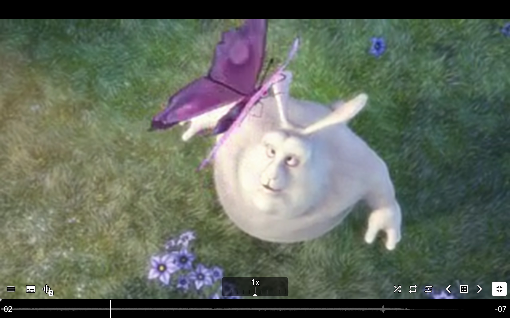

# uosc-waveform

A third-party mpv Lua script that analyzes the selected audio track with FFmpeg and displays a full-track waveform inside the [uosc](https://github.com/tomasklaen/uosc) timeline.

The waveform follows uosc's seekbar geometry and mouse-proximity animation. uosc remains responsible for seeking, chapters, thumbnails, A–B loops, and every other timeline interaction.

> Current source version: **v0.3.1 (unreleased)**
> GitHub Release: **not published yet**
> Primary supported platform: **Windows 10/11**



## Highlights

- Full-track waveform for video and audio-only files
- Supports embedded, external, and multiple audio tracks
- Compatible with audio visualizers that select audio through `lavfi-complex`
- Preserves packet timestamps, leading silence, gaps, stream offsets, and `audio-delay`
- Short audio leaves an empty tail and is never stretched to fill the seekbar
- Bounded-memory FFmpeg analysis followed by a fixed-size Lua BGRA renderer
- One cached bitmap overlay; no redraw tied to playback position
- Asynchronous generation with cancellation and a configurable watchdog
- Race-safe multi-instance cache publication
- Process-aware locks that survive suspend and wake
- Dormant disabled mode and explicit listener/timer cleanup
- Spaces, Unicode filenames, Thai/Japanese text, emoji, and Windows shell metacharacters are supported
- Startup is silent by default

## How it works

1. The script resolves the audio source currently used by mpv, including `current-tracks/audio` when a visualizer uses `lavfi-complex`.
2. FFmpeg converts the selected stream to timestamp-aligned mono analysis frames and emits one `Peak_level` value per timeline segment.
3. Lua maps those values to the media timeline, applies square-root amplitude scaling, and renders a premultiplied BGRA bitmap.
4. The bitmap and a commit manifest are cached as one validated entry.
5. A single mpv bitmap overlay is positioned over the uosc timeline.

The analysis pipeline uses FFmpeg's `asetnsamples`, `astats`, and `ametadata` filters. It does not use `showwavespic`, whose memory use can grow significantly with long media.

The first load of an uncached track analyzes the complete selected audio stream. Later loads use the cache.

## Requirements

| Component | Requirement |
|---|---|
| Operating system | Windows 10/11; Linux is used for automated tests |
| mpv | 0.41.0 stable or a compatible recent development build |
| uosc | 5.12.x |
| FFmpeg | Build containing `asetnsamples`, `astats`, and `ametadata` |
| Media | Local, seekable source with a known positive duration and an audio track |

Network URLs, live streams, stdin, pipes, DVD, and Blu-ray sources are intentionally skipped.

## Installation

When a release is published, download its ZIP from the repository's **Releases** page. Until then, the development ZIP is available as a GitHub Actions artifact from a successful workflow run; it is not a stable release.

### Standard mpv installation

Copy the contents of the ZIP's `portable_config` directory into:

```text
%APPDATA%\mpv\
```

The resulting layout should be:

```text
%APPDATA%\mpv\
├─ scripts\
│  ├─ uosc-waveform.lua
│  └─ uosc_waveform\
│     ├─ cache.lua
│     ├─ controller.lua
│     ├─ ffmpeg.lua
│     ├─ geometry.lua
│     ├─ media.lua
│     ├─ mpv_compat.lua
│     ├─ options.lua
│     ├─ overlay.lua
│     ├─ util.lua
│     ├─ waveform.lua
│     └─ windows_lock.lua
└─ script-opts\
   └─ uosc-waveform.conf
```

Restart mpv after installation.

### Portable mpv installation

Extract the release ZIP next to `mpv.exe`. The included `portable_config` directory is already arranged correctly.

### Audio-only files

mpv needs a visible window for uosc and the bitmap overlay. Add this to `mpv.conf` when playing MP3, FLAC, M4A, Opus, Ogg, WAV, and similar files:

```ini
force-window=yes
```

Audio files with embedded cover art are supported.

## FFmpeg setup

When FFmpeg is available in `PATH`, keep:

```ini
ffmpeg_path=ffmpeg
```

To select an explicit executable:

```ini
ffmpeg_path=C:\Tools\FFmpeg\bin\ffmpeg.exe
```

Do not add shell quotes around the path. It is passed to mpv as one subprocess argument.

Check the required filters:

```bat
ffmpeg.exe -hide_banner -h filter=asetnsamples
ffmpeg.exe -hide_banner -h filter=astats
ffmpeg.exe -hide_banner -h filter=ametadata
```

## Controls

| Key | Action |
|---|---|
| `Alt+w` | Toggle the waveform |
| `Alt+Shift+w` | Show state, generation phase, reason/error, config directory, and log path |

The toggle is also exposed as:

```text
script-message uosc-waveform-toggle
```

A custom `input.conf` binding can call the same message:

```text
Alt+w script-message uosc-waveform-toggle
```

## Configuration

Configuration file:

```text
script-opts/uosc-waveform.conf
```

A practical minimal configuration:

```ini
enabled=yes
ffmpeg_path=ffmpeg
opacity=0.38
color_mode=auto
generation_timeout_seconds=180
startup_osd=no
log_level=warn
```

### Display options

| Option | Default | Accepted values | Description |
|---|---:|---|---|
| `enabled` | `yes` | yes/no | Start with the waveform enabled |
| `opacity` | `0.38` | 0–1 | Premultiplied waveform opacity |
| `color_mode` | `auto` | auto/light/dark | Select waveform contrast mode |
| `light_color` | `#101010` | `#RRGGBB` | Color used against light backgrounds |
| `dark_color` | `#F2F2F2` | `#RRGGBB` | Color used against dark backgrounds |
| `displayed_height_ratio` | `0.78` | 0.05–1 | Fraction of available timeline height used by the waveform |
| `reserved_marker_ratio` | `0.20` | 0–0.8 | Symmetric clearance for uosc timeline markers |
| `reserved_progress_px` | `2` | 0–64 | Minimum clearance for the minimized progress line |
| `minimum_timeline_width` | `320` | 1–16384 | Hide the waveform below this OSD width |
| `overlay_id` | `63` | 0–63 | mpv bitmap-overlay ID |

### Analysis and cache options

| Option | Default | Accepted values | Description |
|---|---:|---|---|
| `ffmpeg_path` | `ffmpeg` | executable path | FFmpeg executable |
| `source_width` | `4096` | 256–16384 | Number of analysis bins and bitmap width |
| `source_height` | `128` | 16–512 | Cached bitmap height |
| `analysis_sample_rate` | `8000` | 1000–192000 | Mono analysis sample rate |
| `generation_timeout_seconds` | `180` | 0–3600 | Abort a stuck FFmpeg process; `0` disables the watchdog |
| `cache_dir` | `~~/cache/uosc-waveform` | local directory | Waveform cache directory |
| `max_cache_age_days` | `60` | 1–3650 | Age target used by grouped cleanup |
| `max_cache_mb` | `512` | 64–1048576 | Size target used by grouped cleanup |
| `stale_lock_seconds` | `900` | 30–604800 | Age before a lock's owner PID is checked |
| `lock_poll_ms` | `500` | 100–5000 | Poll interval while another instance generates the same entry |

Cache cleanup runs after the first ready entry, after every eight newly published entries, or when a ready event occurs at least ten minutes after the last cleanup. It does not use a recurring background timer.

### Runtime and diagnostic options

| Option | Default | Accepted values | Description |
|---|---:|---|---|
| `resize_debounce_ms` | `120` | 0–5000 | Debounce for geometry changes |
| `mouse_update_interval_ms` | `16` | 0–1000 | Mouse-proximity throttle; `0` handles every event |
| `media_debounce_ms` | `250` | 0–5000 | Coalesce rapid media/track changes |
| `compatibility` | `uosc-5.12` | adapter name | Geometry compatibility adapter |
| `adapter_override` | empty | adapter name | Explicit adapter override for testing |
| `startup_osd` | `no` | yes/no | Show a load confirmation banner |
| `diagnostic_log` | `yes` | yes/no | Write the diagnostic log |
| `log_level` | `warn` | error/warn/info/debug | Runtime and diagnostic verbosity |

Invalid or non-finite values fall back to defaults or are clamped to safe ranges.

## Timeline behavior

The bitmap uses the same media-time axis as the uosc seekbar:

- Late audio leaves an empty beginning.
- Early-ending audio leaves an empty tail.
- Audio beyond the media duration is cropped.
- Audio is never compressed or stretched to fill the timeline.
- Positive and negative `audio-delay` shift the waveform.
- `rebase-start-time=no` preserves leading demuxer timeline space.
- Gaps in packet timestamps remain gaps in the waveform.

## Audio selection

The script supports:

- Normal `aid` selection
- `current-tracks/audio` selection through `lavfi-complex`
- Multiple embedded tracks
- External audio files
- Runtime track switching
- FFmpeg stream-index selection
- Source-scoped audio-ordinal fallback when a stream index is unavailable

Changing the active audio source invalidates the current identity and loads or generates the matching cache entry.

## Cache format and concurrency

The default directory is:

```text
<mpv-config>\cache\uosc-waveform\
```

A committed entry contains:

```text
<key>.bgra
<key>.meta
```

The raw bitmap must be exactly:

```text
source_width × source_height × 4 bytes
```

The manifest is committed last and records the cache format, key, dimensions, byte size, and creation time. A raw file without a valid matching manifest is not accepted as a cache hit.

The cache format for this release candidate is **6**. Older entries are ignored and regenerated automatically; manual deletion is not required.

Concurrent mpv instances use exclusive generation locks containing a session owner and process ID. Once `stale_lock_seconds` has elapsed, the lock manager probes the owner PID before classifying the lock as stale; a live owner is not displaced during suspend/wake.

Stale locks are **not automatically unlinked** because another process could replace a stale file between the check and removal. Instead, generation can proceed without lock ownership, and canonical cache publication uses non-replacing operations (atomic hard-link creation on Linux; non-overwriting moves on Windows). If an orphaned `.lock` file remains, close all mpv instances before removing it manually.

## Runtime states

`Alt+Shift+w` reports public state plus internal detail:

```text
state=GENERATING
phase=analyzing
reason=none
error=none
detail=none
```

Public states:

| State | Meaning |
|---|---|
| `DISABLED` | Feature is toggled off; media and mouse work are dormant |
| `UNSUPPORTED` | Current media cannot be analyzed; see `reason` |
| `WAITING_FOR_LOCK` | Another instance is generating the same cache entry |
| `GENERATING` | See `phase=analyzing`, `rendering`, or `publishing` |
| `READY_HIDDEN` | Cache is ready but the uosc timeline is minimized/hidden |
| `READY_VISIBLE` | Waveform overlay is visible |
| `ERROR` | See `error` and `detail` |

Common errors include `generation-timeout`, `ffmpeg-feature-unsupported`, `peak-parse-failed`, `cache-publish-failed`, and `duplicate-instance`.

## Performance characteristics

- The default cached bitmap is fixed at `4096 × 128 × 4 = 2 MiB`.
- FFmpeg emits approximately `source_width` metadata frames instead of constructing a full video frame internally.
- Mouse work is throttled to about 60 updates per second by default.
- Disabled mode schedules no mouse, geometry, or media timers.
- There is no periodic cache-cleanup or lock-heartbeat loop.

Automated Linux release gates include:

- Two-hour audio analysis below **128 MiB peak RSS**
- One million mouse events followed by GC
- Fifty thousand `file-loaded → end-file` lifecycle cycles followed by GC
- Visual-envelope comparison against the previous renderer across silence, impulses, gaps, delays, short audio, and multiple tracks

Native Windows profiling and an eight-hour soak remain required before promoting the release candidate to a stable release.

## Troubleshooting

### No waveform appears

1. Press `Alt+Shift+w` and read `state`, `reason`, `error`, and `detail`.
2. Confirm FFmpeg is available and contains `asetnsamples`, `astats`, and `ametadata`.
3. Confirm the source is local, seekable, and has a positive duration.
4. For audio-only media, enable `force-window=yes`.
5. For visualizers using `lavfi-complex`, confirm mpv exposes `current-tracks/audio`.
6. Confirm uosc's timeline is enabled and the window is wider than `minimum_timeline_width`.

### Enable detailed logging

Set:

```ini
log_level=debug
diagnostic_log=yes
```

Restart mpv, reproduce the issue, and inspect:

```text
<mpv-config>\uosc-waveform.log
```

The log rotates at 2 MiB to `uosc-waveform.log.old`.

### Script does not load

Run:

```text
diagnose-uosc-waveform.cmd
```

It creates `uosc-waveform-diagnostic-report.txt` with environment and file-layout information.

### Overlay conflict

The default bitmap overlay ID is `63`. Change it if another bitmap-overlay script uses the same ID:

```ini
overlay_id=62
```

## Known limitations

- Bitmap overlays are rendered above uosc's ASS layer. Exact compositing would require integration inside uosc.
- uosc has no public timeline-state API. Normal proximity and cursor-leave behavior are mirrored, but private states such as every forced flash/toggle transition cannot be observed perfectly.
- The first uncached generation still decodes the complete selected audio stream.
- The waveform represents the selected source track plus global `audio-delay`; it does not render the final output after equalizers, compressors, tempo processing, or arbitrary mixing filters.
- Ordered Matroska editions, linked segments, and unusual external timestamp origins are best effort.
- Replacing a file while preserving both byte size and modification time can reuse its previous identity.
- PID liveness protects normal suspend/wake behavior, but a PID reused by the operating system after an unclean crash can delay stale-lock recovery until the next process state change.

## Development

Run the complete Linux/macOS test suite:

```bash
LUA_BIN=lua5.4 tools/run-tests.sh
```

Run on Windows PowerShell:

```powershell
$env:LUA_BIN = 'lua.exe'
tools\run-tests.ps1
```

Build a deterministic verified ZIP:

```bash
python3 tools/package-release.py
```

CI tests Lua 5.2, Lua 5.4, LuaJIT, Windows, FFmpeg integration, stress/GC behavior, visual parity, and source-to-ZIP byte equality.

## Project structure

```text
portable_config/
├─ scripts/
│  ├─ uosc-waveform.lua
│  └─ uosc_waveform/
└─ script-opts/
   └─ uosc-waveform.conf

tests/
├─ helpers/
├─ integration/
└─ stress/

tools/
.github/workflows/test.yml
```

## Contributing

Bug reports should include:

- mpv, uosc, and FFmpeg versions
- Relevant uosc timeline configuration
- `uosc-waveform.conf`
- The complete `Alt+Shift+w` status
- Relevant log lines captured with `log_level=debug`

Do not upload private media. A small synthetic reproducer is preferred.

## License

Released under the [MIT License](LICENSE).

This project is a third-party extension and is not part of or officially affiliated with uosc.
